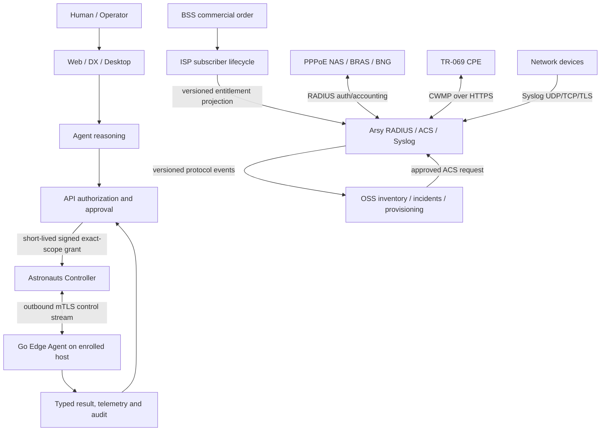

# Workspace dependency graph — audited baseline

**Audit date:** 2026-11-27  
**Audited commit:** `c1c604801e4bbde982a44689aac7b6c48b1978ee`  
**Task:** PKG-001

## Actual graph

```text
MoonWitness repository
├── root package: moonwitness (private)
│   ├── check:repo  -> node scripts/check-repo.mjs
│   ├── test        -> node --test
│   └── check       -> check:repo + test
├── apps/*          -> workspace pattern only; no child package exists
├── packages/*      -> workspace pattern only; no child package exists
├── docs/*          -> Markdown/JSON governance and architecture sources
└── scripts/*       -> repository validation scripts
```

The lockfile contains one importer (`.`) with no dependencies. Therefore the actual application/package dependency graph is currently empty.

## Verified toolchain path

```text
GitHub Actions
  -> checkout
  -> install pnpm 10.8.1
  -> setup Node.js from .nvmrc (22.14.0)
  -> pnpm install --frozen-lockfile
  -> pnpm check:repo
  -> pnpm test
```

This path passed on main after PR #1. It verifies repository integrity and tests, not application build output.

## Architectural direction (not yet materialized)

The blueprint constrains future dependency direction:

- Apps consume public package exports and API contracts.
- Packages do not import app internals.
- Frontends do not import Fastify, MikroORM or server-only adapters.
- Agent and DX do not import API persistence internals.
- API composes platform model/ORM and domain capabilities.
- No app is automatically a separate microservice or database.

The exact package nodes and edges are intentionally left undefined until actual package owners, consumers and contracts are implemented. Candidate package families in `BLUEPRINT-PACKAGE.MD` are not evidence that those packages exist.

## Current blockers to a generated graph

- No application child package manifests.
- No reusable package manifests.
- No `turbo.json` or Turbo task definitions.
- No dependency extraction or architecture-boundary checker.

Do not create a guessed graph from blueprint names. Build the graph from manifests/imports after the first real packages exist.


## Machine and telecom execution flows



- Cloud provisions the machine resource; Astronauts enrolls and controls its host agent afterward.
- DX owns local coding worktrees; Astronauts owns remote fleet execution. These are not competing terminal implementations.
- Arsy terminates/handles telecom protocols; OSS and ISP remain the workflow/domain owners.
- API authorization and audit contracts are mandatory across all arrows; none of the app runtimes share private databases.
